<!-- i18n-source: README.md@f4a2589fd7640b054cafe0fe7d23b6031a10affa status=reviewed -->
<!-- brand:start -->

<p align="center"><picture><source media="(prefers-color-scheme: dark)" srcset="https://raw.githubusercontent.com/muhittincamdali/fmdrift/main/.github/brand/banner-dark.svg"><source media="(prefers-color-scheme: light)" srcset="https://raw.githubusercontent.com/muhittincamdali/fmdrift/main/.github/brand/banner-light.svg"></picture></p>

<!-- lang-selector:start -->
<p align="center"><a href="README.md">English</a> · <a href="README.tr.md">Türkçe</a> · <a href="README.zh-CN.md">简体中文</a> · <a href="README.ja.md">日本語</a> · <a href="README.ko.md">한국어</a> · <a href="README.es.md">Español</a> · <a href="README.de.md">Deutsch</a> · <a href="README.fr.md">Français</a> · <a href="README.pt-BR.md">Português (Brasil)</a> · <a href="README.ru.md">Русский</a></p>
<!-- lang-selector:end -->

<p align="center">
<a href="https://github.com/muhittincamdali/fmdrift/actions/workflows/ci.yml"></a>
<a href="https://github.com/muhittincamdali/fmdrift/blob/main/Package.swift"><picture><source media="(prefers-color-scheme: dark)" srcset="https://raw.githubusercontent.com/muhittincamdali/fmdrift/main/.github/brand/badge-platforms-dark.svg"><source media="(prefers-color-scheme: light)" srcset="https://raw.githubusercontent.com/muhittincamdali/fmdrift/main/.github/brand/badge-platforms-light.svg"></picture></a>
<a href="https://github.com/muhittincamdali/fmdrift/blob/main/Package.swift"><picture><source media="(prefers-color-scheme: dark)" srcset="https://raw.githubusercontent.com/muhittincamdali/fmdrift/main/.github/brand/badge-language-dark.svg"><source media="(prefers-color-scheme: light)" srcset="https://raw.githubusercontent.com/muhittincamdali/fmdrift/main/.github/brand/badge-language-light.svg"></picture></a>
<a href="https://github.com/muhittincamdali/fmdrift/blob/main/LICENSE"><picture><source media="(prefers-color-scheme: dark)" srcset="https://raw.githubusercontent.com/muhittincamdali/fmdrift/main/.github/brand/badge-license-dark.svg"><source media="(prefers-color-scheme: light)" srcset="https://raw.githubusercontent.com/muhittincamdali/fmdrift/main/.github/brand/badge-license-light.svg"></picture></a>
</p>

<p align="center">
<a href="#início-rápido"><picture><source media="(prefers-color-scheme: dark)" srcset="https://raw.githubusercontent.com/muhittincamdali/fmdrift/main/.github/brand/button-start-pt-BR-dark.svg"><source media="(prefers-color-scheme: light)" srcset="https://raw.githubusercontent.com/muhittincamdali/fmdrift/main/.github/brand/button-start-pt-BR-light.svg"></picture></a>
<a href="https://muhittincamdali.github.io/fmdrift/"><picture><source media="(prefers-color-scheme: dark)" srcset="https://raw.githubusercontent.com/muhittincamdali/fmdrift/main/.github/brand/button-docs-pt-BR-dark.svg"><source media="(prefers-color-scheme: light)" srcset="https://raw.githubusercontent.com/muhittincamdali/fmdrift/main/.github/brand/button-docs-pt-BR-light.svg"></picture></a>
<a href="https://github.com/muhittincamdali/fmdrift/tree/main/docs/guides"><picture><source media="(prefers-color-scheme: dark)" srcset="https://raw.githubusercontent.com/muhittincamdali/fmdrift/main/.github/brand/button-guides-pt-BR-dark.svg"><source media="(prefers-color-scheme: light)" srcset="https://raw.githubusercontent.com/muhittincamdali/fmdrift/main/.github/brand/button-guides-pt-BR-light.svg"></picture></a>
<a href="https://github.com/muhittincamdali/fmdrift/tree/main/Examples"><picture><source media="(prefers-color-scheme: dark)" srcset="https://raw.githubusercontent.com/muhittincamdali/fmdrift/main/.github/brand/button-examples-pt-BR-dark.svg"><source media="(prefers-color-scheme: light)" srcset="https://raw.githubusercontent.com/muhittincamdali/fmdrift/main/.github/brand/button-examples-pt-BR-light.svg"></picture></a>
</p>

> Esta é uma tradução do README em inglês. Se houver diferença, vale a versão em inglês.

<!-- brand:end -->

O foundation model que a Apple executa no dispositivo muda com as atualizações do sistema operacional, e a Apple recomenda testar seus
prompts no modelo antigo e no novo e comparar a saída ([Updating prompts for new model
versions](https://developer.apple.com/documentation/foundationmodels/updating-prompts-for-new-model-versions)).
O fmdrift faz isso pela linha de comando: executa os prompts de uma suíte YAML no modelo do
Mac em que está rodando, verifica cada resposta, registra os resultados por build do sistema operacional e mostra quais respostas
mudaram ou quebraram no build seguinte. Perguntada na WWDC26 sobre uma versão do modelo em tempo de execução, a Apple respondeu
que "o sinal prático hoje é a versão do sistema operacional", e é isso que o fmdrift registra
([Machine Learning & AI Group Lab](https://developer.apple.com/videos/play/wwdc2026/8016/), 15:07).

<picture><source media="(prefers-color-scheme: dark)" srcset="docs/media/demo-run-dark.svg"><source media="(prefers-color-scheme: light)" srcset="docs/media/demo-run-light.svg"></picture>

<sub>Gravado com o comando real e o modelo real no dispositivo (<code>node scripts/demo.mjs</code>)
em <a href="Examples/support-app">Examples/support-app</a>, macOS 27.0.1 (26A434), Mac17,6 (Apple
M5 Max).</sub>

## Destaques

- **Prompts e verificações em um só arquivo.** Uma suíte YAML guarda cada prompt com suas instruções,
  amostragem, guardrails e caso de uso, além das verificações que suas respostas precisam passar: texto, expressões
  regulares, valores JSON, tamanho, latência, tokens de saída e se o modelo recusa.
- **Saída estruturada também.** Dê um JSON Schema a um caso e o fmdrift pede guided generation
  (`DynamicGenerationSchema`), verifica o resultado contra o esquema e lê valores por caminho.
- **Estabilidade, não uma resposta de sorte.** Cada caso pode rodar várias vezes em sessões novas;
  o relatório mostra quantas execuções passaram e quantas deram a mesma resposta.
- **Snapshots por build do sistema operacional.** `record` salva cada resposta, latência e contagem de tokens como JSON sob
  o build do sistema operacional que a produziu. `run --baseline` e `diff` mostram o que regrediu, mudou ou foi corrigido,
  com um diff palavra por palavra das respostas.
- **Uma correção para cada falha, com sua fonte.** Violações de guardrails, recusas, janela de contexto, idiomas,
  problemas de esquema, latência e regressões vêm cada um com uma sugestão ligada à
  documentação da Apple.
- **Feito para CI.** Saída em terminal, Markdown, JUnit XML e JSON, e códigos de saída. Runners sem
  Apple Intelligence ainda podem validar suítes e verificar de novo as respostas gravadas.

## Início rápido

**1. Instale** (macOS 26 ou posterior, com [Homebrew](https://brew.sh)):

```sh
brew install muhittincamdali/tap/fmdrift
```

**2. Escreva uma suíte.** `fmdrift init` cria `fmdrift.yaml` com dois casos que funcionam; troque-os
pelos prompts que seu app envia.

```sh
fmdrift init
```

**3. Execute e grave.** `fmdrift run` verifica cada resposta no modelo deste Mac. `fmdrift record` salva as respostas deste build do sistema operacional em `fmdrift-snapshots/`; faça commit dessa pasta. Depois da
próxima atualização do sistema operacional, `fmdrift run --baseline fmdrift-snapshots` mostra o que mudou.

```sh
fmdrift run
fmdrift record
```

`fmdrift doctor` informa se este Mac consegue executar o modelo e qual build do sistema operacional ele registraria.
[Escreva sua primeira suíte](docs/guides/write-your-first-suite.md) percorre o processo passo a passo.

## O que funciona hoje

| Recurso | Status |
| --- | --- |
| Suítes YAML ou JSON com valores padrão, instruções, amostragem, temperature, limite de tokens de resposta, guardrails e caso de uso por caso | funciona |
| Verificações: `contains`, `containsAny`, `notContains`, `equals`, `oneOf`, `matches`, `notMatches`, `minLength`, `maxLength`, `atLeast`, `atMost`, `maxLatency`, `maxOutputTokens`, `refusal` | funciona |
| Guided generation a partir de um subconjunto de JSON Schema, validação de esquema, verificações por caminho JSON | funciona |
| Repetições com uma taxa de aprovação exigida e concordância entre as execuções | funciona |
| Snapshots de `record` por build do sistema operacional; `run --baseline` e `diff` com casos regredidos, alterados, corrigidos, adicionados e removidos e limites de latência | funciona |
| `run --replay`: verificar de novo respostas gravadas sem um modelo | funciona |
| Saída em terminal, Markdown, JUnit XML e JSON; códigos de saída 0, 1, 2 | funciona |
| Biblioteca FMDriftKit com documentação DocC | funciona |
| Executar uma suíte no Private Cloud Compute ou em outro provedor de `LanguageModel` | planejado (0.2) |
| Casos com tool-calling | planejado (0.3) |

## fmdrift e o Evaluations framework da Apple

O Xcode 27 trouxe o [Evaluations framework](https://developer.apple.com/documentation/evaluations)
da Apple (macOS 27 e posterior): avaliações escritas em Swift dentro de um target de testes, com modelos avaliadores,
avaliadores de tool-calls e relatórios no Xcode. Use-o quando suas verificações precisarem de código Swift ou de um
modelo avaliador. O fmdrift é para o outro lado do mesmo trabalho:

- a suíte é um arquivo YAML que quem não escreve Swift consegue ler e editar,
- os resultados são arquivos JSON simples no git, um por build do sistema operacional, comparados pela linha de comando em qualquer
  sistema de CI,
- o pacote compila para o macOS 26, onde o Evaluations framework não está disponível, então as
  respostas do modelo anterior também podem ser gravadas (as execuções reais desta versão foram verificadas
  apenas no macOS 27.0.1).

## Instalação

| Método | Comando |
| --- | --- |
| Homebrew | `brew install muhittincamdali/tap/fmdrift` |
| Binário da versão | Baixe `fmdrift-<version>-macos-arm64.tar.gz` em [Releases](https://github.com/muhittincamdali/fmdrift/releases), confira com `SHA256SUMS` e coloque `fmdrift` no seu `PATH` |
| Pelo código-fonte | `git clone https://github.com/muhittincamdali/fmdrift.git && cd fmdrift && swift build -c release` (o binário é `.build/release/fmdrift`) |
| Pacote Swift | `.package(url: "https://github.com/muhittincamdali/fmdrift", from: "0.1.0")`, produto `FMDriftKit` |

## Uso

### Escrever casos

```yaml
name: support
defaults:
    repeat: 3 # three new sessions per case; all must pass
    instructions: You help the support team of a photo-editing app.
cases:
    - id: ticket-summary
      prompt: 'Summarize: "I was charged twice for the yearly plan. Order 4417."'
      expect:
          - containsAny: [charged twice, double charge]
            ignoreCase: true
          - contains: "4417"
          - notContains: [will refund]
          - maxLength: 240
          - maxLatency: 2s

    - id: ticket-triage
      prompt: 'Triage: "The app crashes when I open Export."'
      schema: # guided generation; the answer is JSON
          type: object
          required: [category, urgency]
          properties:
              category: { type: string, enum: [billing, bug, account, other] }
              urgency: { type: integer, minimum: 1, maximum: 5 }
      expect:
          - path: category
            equals: bug
```

Cada chave, com seus limites, está na [referência do formato de suíte](https://muhittincamdali.github.io/fmdrift/documentation/fmdriftkit/suiteformat).
`fmdrift validate` verifica uma suíte sem um modelo e, diante de uma chave desconhecida, indica aquela que
você provavelmente quis escrever.

### Comparar builds do sistema operacional

```sh
fmdrift record                                  # on the current OS: fmdrift-snapshots/<suite>/macOS-26.4-25E246.json
# … update macOS, or install a beta …
fmdrift run --baseline fmdrift-snapshots        # compares with the newest snapshot of another build
fmdrift diff fmdrift-snapshots/support/macOS-26.4-25E246.json fmdrift-snapshots/support/macOS-27.0.1-26A434.json
```

Um caso que passava antes e falha agora **regrediu** (`regressed`) e faz a execução falhar (status de saída 1).
`--fail-on changed` também falha nas respostas que mudaram mas ainda passam, e
`--max-latency-increase 50%` nos casos que ficaram mais lentos. Quando o prompt, as instruções, as opções ou
o esquema mudaram entre as duas execuções, o relatório avisa, para que um prompt editado não seja confundido com
um modelo novo.

<picture><source media="(prefers-color-scheme: dark)" srcset="docs/media/demo-drift-dark.svg"><source media="(prefers-color-scheme: light)" srcset="docs/media/demo-drift-light.svg"></picture>

<sub>Uma execução real no macOS 27.0.1 (26A434): as instruções do exemplo foram encurtadas para "Answer in
at most eight words." e comparadas com o snapshot versionado. O pedido fora do assunto que o
modelo havia recusado com o texto "Unable to work with that request." agora lançou
<code>guardrailViolation</code>. Havia apenas um build do sistema operacional disponível para esta versão, então esta demo
muda o prompt em vez do sistema operacional; o relatório é o mesmo.</sub>

### Verificar respostas gravadas sem um modelo

```sh
fmdrift run --replay fmdrift-snapshots
```

O replay executa as verificações da suíte atual sobre as respostas de um snapshot. Funciona em qualquer Mac,
inclusive em runners de CI sem Apple Intelligence, e detecta uma verificação que não corresponde mais ao
que o modelo disse. Um caso cujo prompt mudou desde a gravação é marcado.

### Relatórios para CI

```sh
fmdrift run --junit fmdrift-junit.xml --markdown "$GITHUB_STEP_SUMMARY"
fmdrift run --json | jq '.runs[].cases[] | select(.passed | not) | .id'
```

| Status de saída | Significado |
| --- | --- |
| 0 | Todos os casos passaram e nada regrediu |
| 1 | Um caso falhou ou regrediu (`validate`: uma suíte é inválida; `doctor`: sem modelo) |
| 2 | Argumentos incorretos, uma suíte ou um snapshot ilegível, ou nenhum modelo para executar |

`--allow-unavailable` transforma a falta de um modelo em uma nota e status 0, para runners sem Apple
Intelligence. [fmdrift no CI](docs/guides/fmdrift-in-ci.md) traz um workflow completo do GitHub Actions.

## Como é testado

- **No modelo real.** [Examples/support-app](Examples/support-app) foi gravado no macOS
  27.0.1 (26A434), Mac17,6 (Apple M5 Max): 15 gerações, todas aprovadas, 9.70 s para a execução inteira,
  com medianas entre 374 ms e 826 ms por resposta. Um teste reproduz esse snapshot pela linha de
  comando a cada execução do CI. Mais dois testes pedem ao modelo real uma resposta simples e uma estruturada
  quando `FMDRIFT_LIVE=1` está definido.
- **O que o modelo real ensinou aos testes.** Dez execuções greedy do prompt de triagem retornaram os
  mesmos valores em quatro ordens de chaves diferentes, então as respostas estruturadas são comparadas por valor. O
  pedido fora do assunto foi recusado com texto, não com um erro, como alerta o
  [artigo de segurança](https://developer.apple.com/documentation/foundationmodels/improving-the-safety-of-generative-model-output)
  da Apple, e com instruções mais curtas o mesmo pedido lançou `guardrailViolation`.
- **Todos os formatos de relatório** são comparados byte a byte com os arquivos em
  [Fixtures/expected](Fixtures/expected), a partir de uma baseline fixa e de uma execução atual que cobrem cada
  tipo de resultado.
- **Texto não confiável.** A saída do modelo pode conter sequências de escape de terminal, sobreposições bidirecionais ou
  marcação; os testes passam OSC 52, limpeza de tela, uma sobreposição da direita para a esquerda, HTML e NUL pelos
  relatórios de terminal, Markdown e JUnit. Os leitores de suíte e de snapshot recusam arquivos grandes demais,
  aninhamento profundo e bombas de alias de YAML.
- **Todos os comandos no mesmo processo**, contra um modelo roteirizado com um build do sistema operacional escolhido, incluindo
  gravar em um build, executar em outro, políticas de diff, replay, a falta de um modelo e
  arquivos ilegíveis.

122 testes. Todos passam em um Mac (Apple silicon) com macOS 27.0.1 e Xcode 27.1; o workflow de CI
os executa com Xcode 26.6 e Xcode 27.

## Limites

- As execuções reais precisam de um Mac com Apple silicon e Apple Intelligence ativado. Os runners de macOS
  hospedados pelo GitHub são máquinas virtuais sem isso; neles o fmdrift pode validar, reproduzir com replay e comparar com diff.
- O modelo de um Mac e o de um iPhone com a mesma versão do sistema operacional podem não responder da mesma forma.
  O fmdrift roda apenas no macOS e rotula cada snapshot com o Mac e o sistema operacional de onde veio.
- `refusal: true` passa com um erro `guardrailViolation` ou `refusal`. Uma recusa escrita como texto
  ("Desculpe, não posso ajudar com isso") é uma resposta comum: verifique as palavras dela com `containsAny`.
  A Apple observa que nem sempre é possível distinguir, no código, uma recusa em texto de uma resposta.
- A latência inclui a criação da sessão; a primeira resposta de uma execução pode ser mais lenta enquanto o modelo
  carrega. Compare a latência entre snapshots do mesmo Mac.
- A contagem de tokens de saída vem da resposta no macOS 27 e de `tokenCount(for:)` no macOS
  26.4 a 26.x; antes da 26.4, `maxOutputTokens` é ignorado e isso é informado.
- O [artigo sobre a janela de contexto](https://developer.apple.com/documentation/foundationmodels/managing-the-context-window)
  da Apple fala em 4,096 tokens; `contextSize` informou 8,192 no macOS 27.0.1 (26A434). `fmdrift doctor`
  mostra o valor do Mac em uso.

## Requisitos

| Plataforma | Versão mínima |
| --- | --- |
| macOS (validate, replay, diff) | 26.0 |
| macOS (execuções reais) | 26.0 em Apple silicon com Apple Intelligence; verificado no 27.0.1 |
| Ferramentas (compilar pelo código-fonte) | Swift 6.2, Xcode 26.4 ou posterior |

## Arquitetura

- `Sources/FMDriftKit`: `SuiteLoader` lê suítes em `Suite` e `TestCase`; `Evaluator` e
  `SchemaValidator` verificam uma `Generation`; `Runner` consulta um `ModelProvider`
  (`SystemModelProvider` para o modelo no dispositivo, `ReplayProvider` para snapshots) e monta um
  `RunResult`; `SnapshotStore` o lê e o grava; `SnapshotDiff` compara dois; `Advice` associa
  as falhas à documentação da Apple; `Reports/` gera texto, Markdown, JUnit XML e JSON.
- `Sources/FMDriftCLI`: os comandos e os códigos de saída; `Sources/fmdrift` apenas os inicia.
- Cada geração usa uma `LanguageModelSession` nova, então nenhum caso vê o transcript de outro.
- Os erros são classificados pelo nome do case porque o macOS 27 os moveu de `GenerationError` para
  `LanguageModelError`; o mesmo binário funciona nos dois.

## Documentação

- [Guias](docs/guides/): escrever sua primeira suíte, detectar drift depois de uma atualização do sistema operacional, fmdrift no CI.
- [API e formato de suíte](https://muhittincamdali.github.io/fmdrift/) (DocC) do FMDriftKit.
- [Exemplos](Examples/): a suíte support-app com seu snapshot, um programa Swift sobre o FMDriftKit,
  um workflow do GitHub Actions.
- [Registro de mudanças](CHANGELOG.md).

## Fontes

Documentação e sessões da Apple em que o comportamento e as sugestões do fmdrift se baseiam, lidas em 28 de outubro de 2026:

- [Updating prompts for new model versions](https://developer.apple.com/documentation/foundationmodels/updating-prompts-for-new-model-versions)
- [Evaluating prompts to measure performance and improve model responses](https://developer.apple.com/documentation/foundationmodels/evaluating-prompts-to-measure-performance-and-improve-model-responses)
- [Machine Learning & AI Group Lab, WWDC26](https://developer.apple.com/videos/play/wwdc2026/8016/): a versão do sistema operacional como sinal do modelo (15:07), cerca de duas atualizações do modelo por ano, feitas em versões beta
- [Prompting an on-device foundation model](https://developer.apple.com/documentation/foundationmodels/prompting-an-on-device-foundation-model)
- [Generating Swift data structures with guided generation](https://developer.apple.com/documentation/foundationmodels/generating-swift-data-structures-with-guided-generation)
- [Improving the safety of generative model output](https://developer.apple.com/documentation/foundationmodels/improving-the-safety-of-generative-model-output) e [permissiveContentTransformations](https://developer.apple.com/documentation/foundationmodels/systemlanguagemodel/guardrails/permissivecontenttransformations)
- [Managing the context window](https://developer.apple.com/documentation/foundationmodels/managing-the-context-window)
- [Supporting languages and locales with Foundation Models](https://developer.apple.com/documentation/foundationmodels/supporting-languages-and-locales-with-foundation-models)
- [Analyzing the runtime performance of your Foundation Models app](https://developer.apple.com/documentation/foundationmodels/analyzing-the-runtime-performance-of-your-foundation-models-app)
- [SystemLanguageModel.Availability](https://developer.apple.com/documentation/foundationmodels/systemlanguagemodel/availability-swift.enum)
- [Evaluations](https://developer.apple.com/documentation/evaluations)

## Como contribuir

O que mais ajuda é uma suíte que mostre um veredito errado, junto com o snapshot que o produziu. Veja
[CONTRIBUTING.md](CONTRIBUTING.md) para compilar, testar e conhecer os arquivos gravados, e
[SECURITY.md](SECURITY.md) para relatar uma vulnerabilidade de forma privada.

## Licença

[MIT](LICENSE)
